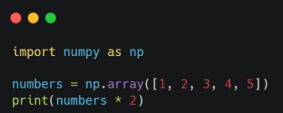

# Python Científico
## de la ecuación al programa
### Clase 4a



- `def`, `lambda`, `map`, `sorted`, y `filter`
-  definición de funciones

---
# Numpy para todes

## Que son?

NumPy (Numerical Python) es una biblioteca fundamental del ecosistema científico de Python. Permite representar y operar con vectores, matrices y arreglos numéricos de manera eficiente. Se utiliza en prácticamente todas las áreas de la física computacional: análisis de datos experimentales, resolución numérica de ecuaciones, simulaciones, procesamiento de señales y cálculo científico.

Supongamos que queremos calcular la posición de una partícula que se mueve con velocidad constante:
$$
x(t)=x0+v
~t
$$
esto la calculariamos utilizando una lista:
```python
x0 = 2.0
v = 3.0
tiempos = [0.0, 0.1, 0.2, 0.3, 0.4]
x = [x0 + v * t for t in tiempos]

print(x)
```

Con NumPy, la misma operación se expresa directamente:
```python
import numpy as np

x0 = 2.0
v = 3.0
t = np.array([0.0, 0.1, 0.2, 0.3, 0.4])

x = x0 + v * t

print(x)
```
La segunda expresión aplica la operación a todos los elementos del arreglo. Esta característica se llama **vectorización**.

NumPy ofrece tres ventajas principales:
* **Eficiencia**: las operaciones numéricas se ejecutan mediante código compilado, generalmente mucho más rápido que los ciclos explícitos de Python para arreglos grandes.
* **Expresividad:** las ecuaciones se escriben de una forma cercana a su notación matemática.
* **Integración**: sus arreglos se utilizan en bibliotecas como SciPy, Matplotlib y pandas.

## El objeto estrella`np.array`

Veamos unos ejemplos:
```python
import numpy as np

vector = np.array([270.0, 275.0, 280.0, 285.0])

matriz = np.array([
    [1.0, 2.0, 3.0],
    [4.0, 5.0, 6.0]
])

print(f"{vector = }")
print(f"{matriz = }")
```
propiedades basicas:
```python
print(f"{matriz.ndim = }") 
print(f"{matriz.shape = }")
print(f"{matriz.size = }")
print(f"{matriz.dtype = }")
```

## Creacion de arreglos


```python
print(f"{np.zeros(4) = }")          # np.zeros_like 
print(f"{np.ones(4) = }")           # np.ones_lile
print(f"{np.full(4, 123.4) = }")    # np.full_like

print()

print(f"{np.arange(0, 10, 2) = }")
print(f"{np.linspace(0, 10, 7)= }")
```

## Aritmetica y funciones

```python
a = np.array([1, 2, 3])
b = np.array([10, 20, 30])

print(f"{ a + b = }")
print(f"{ np.exp(a) = }")
```

## Indexación de matrices

```python
M = np.array([
    [1, 2, 3],
    [4, 5, 6],
    [7, 8, 9]
])

print(f"{M[1, 2] = }")  
print(f"{M[2, :] = }")  
print(f"{M[:, 1] = }")
```

La notación `M[fila, columna]` permite acceder a un elemento; `:` selecciona todos los elementos de una dimensión.


___
___
