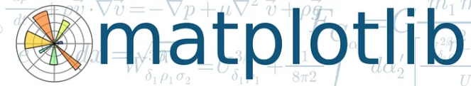

# Python Científico
## de la ecuación al programa
### Clase 4b



- `matplotlib`

---
# Una imagen vale mas que mil palabras

## Que es?

**Matplotlib**  es una biblioteca de Python que permite representar datos mediante gráficos. En física y otras ciencias se utiliza para visualizar mediciones experimentales, analizar resultados de simulaciones, comparar modelos teóricos y estudiar la evolución de magnitudes físicas.

## Primer gráfico: representar una función

Comencemos con un ejemplo sencillo: representar la función
$$
y = x^2
$$
Creamos un conjunto de valores de  `x`, calculamos `y` y graficamos los resultados.
esto la calculariamos utilizando  NumPy:
```python
import numpy as np
import matplotlib.pyplot as plt

x = np.linspace(-5, 5, 100)
y = x**2

plt.plot(x, y)
plt.show()
```

Podriaamos mejorar un poco este grafico haciendo:
```python
import numpy as np
import matplotlib.pyplot as plt

x = np.linspace(-5, 5, 100)
y = x**2

plt.plot(x, y)

plt.title("Función cuadrática")
plt.xlabel("x")
plt.ylabel("y = x²")

plt.grid(True)
plt.show()
```

## Resumen de las funciones principales

| Función                         | Uso                               |
| ------------------------------- | --------------------------------- |
| `plt.plot(x, y)`                | Gráfico de líneas.                |
| `plt.scatter(x, y)`             | Gráfico de puntos.                |
| `plt.title()`                   | Título.                           |
| `plt.xlabel()` / `plt.ylabel()` | Etiquetas de los ejes.            |
| `plt.legend()`                  | Leyenda.                          |
| `plt.grid(True)`                | Cuadrícula.                       |
| `plt.xlim()` / `plt.ylim()`     | Límites de los ejes.              |
| `plt.figure()`                  | Crear una figura.                 |
| `plt.savefig()`                 | Guardar la figura.                |
| `plt.show()`                    | Mostrar la figura.                |
Hay miles de opciones! Podemos darnos una idea de lo que se puede hacer viedo la galeria de [[https://matplotlib.org/stable/plot_types/index.html#plot-types]]

---
---
