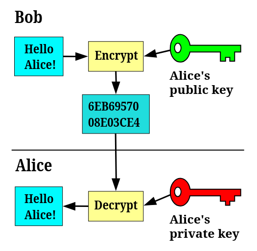
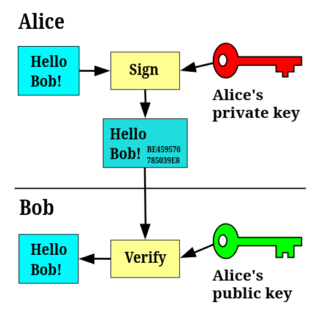

# Python Científico
## de la ecuación al programa
### Clase 5 - Compartir


- Intercambio de archivos via `ssh`
- Repositorios `git`

---

## Instalacion mínima
<style scoped> section { font-size: 30px; } </style>
```bash
# Debian / Ubuntu Linux
sudo apt install git openssh-client

# Windows (en powershell)
winget install --id Git.Git -e
```

* En Windows, los comandos son iguales que en Linux, pero se ejecutan en la ventana `Git Bash` que viene con el git
* Durante la instalación elegir todos los path por defecto
  ```bash
  # chequeo de instalación
  git --version 
  ssh -V
  ```

---

## Intercambio de archivos y comandos


- confidencialidad
- integridad
- autentificación
---
## Encriptado: claves simétricas
<style scoped> section { font-size: 27px; } </style>

Una función de encriptado utiliza una clave $k$ para encriptar un mensaje $m$

El resultado es un mensaje encriptado $x$:

$$
E(k,m)=x  
$$ 
$$
E(k,x) = m
$$

Todo el truco consiste en que la función de encriptado es muy difícil de invertir: aún conociendo el mensaje y su encriptado, es casi imposible obtener la clave, y por lo tanto no podemos leer ni encriptar otros mensajes.

El sistema más usado es el [_Advanced Encryption Standard (AES)_](https://en.wikipedia.org/wiki/Advanced_Encryption_Standard).

---

## Encriptado: claves asimétricas
<style scoped> section { font-size: 27px; } </style>

las claves se generan de a pares 
- $pk$ private key  
- $sk$ shared key

Las dos claves tienen un rol simétrico: puedo encriptar con la clave privada y desencriptado con la pública **usando la misma función**:

$$
E(sk,m)=x  \ \ \ \ \ \ \ E(pk,x)=m
$$
pero también puedo hacerlo al revés:
$$
E(pk,m)=x \ \ \ \ \ \ \ E(sk,x)=m
$$

El sistema más usado es el [_Rivest–Shamir–Adleman (RSA)_](https://en.wikipedia.org/wiki/RSA_\(cryptosystem\)).

---

##  Claves asimétricas: encriptado



- _Alice_ comparte su clave pública y _Bob_ el envía un mensaje encriptado con esa clave.  
  
- Sólo ella puede leer el mensaje encriptado, porque es la única que tiene la clave privada.

---

##  Claves asimétricas: firma
<style scoped> section { font-size: 25px; } </style>



- _Alice_ quiere enviar un mensaje a _Bob_, que conoce la clave pública de _Alice_.  
El mensaje no está encriptado, pero nos interesa incluir una firma digital.  
  
- _Alice_ calcula un hash del mensaje y lo encripta con su clave privada. El resultado se envía al final del mensaje.  
Gracias a la simetría de las claves _Bob_ puede desencriptar la firma y chequear que coincide con el hash del mensaje.  
  
- Para incluir una firma del mensaje, se necesita tener el mensaje y la clave privada de _Alice_, por eso ella es la única en condiciones de hacerlo.

---

### Certificados
<style scoped> section { font-size: 23px; } </style>

Quién me asegura que la clave pública es de quién dice ser?

_Certificate authority_ (CA): sitios consultados con un protocolo específico para eso (OCSP). Estos sitios distribuyen claves públicas verificadas y las firman.

Las [opciones para distribuir certificados](https://www.digitalocean.com/community/tutorials/a-comparison-of-let-s-encrypt-commercial-and-private-certificate-authorities-and-self-signed-ssl-certificates) son

- **Commercial Certificate Authorities**  
    Son sistemas pagos pero están aceptados por todos los navegadores.
    
- **Let’s Encrypt**  
    Gratis y de carga automática con Apache y Nginx. No acepta IPs sin nombre de dominio.
    
- **Self-Signed Certificates**  
    Certificados firmados por uno mismo. Su seguridad como verificación es nula, pero funciona en el navegador si se acepta explícitamente. El riesgo no es de acceso indebido, sino de phishing.
- **Trust on first use** (TOFU)  
     recuerda la clave pública de la primera conexión
 
 ---

## Primer conexión con contraseña
<style scoped> section { font-size: 30px; } </style>

```bash
ssh usuario@host
```

- _host_: python.local (192.168.0.100)
- primer conexión: pide confirmar que el servidor es quien dice ser.
- pide la contraseña y estamos en el servidor !!!
- un par de comandos para explorar
  ```bash
  pwd     # dónde estoy
  ls -la  # listar archivos
  cd ~    # ir a carpeta raíz
  exit    # salir de la conexión
  ```

---

### Comando remoto

```bash
ssh usuario@host "hostname && pwd && ls"
```

- no pide confirmación.   
 ```bash
 ls ~/.ssh  # known_hosts
 ```

- si cambiara la clave pública del servidor aparece un cartel:

WARNING: REMOTE HOST IDENTIFICATION HAS CHANGED

---

## Gestionar claves
<style scoped> section { font-size: 30px; } </style>

| acción          | cmd                                                |
| --------------- | -------------------------------------------------- |
| generar claves  | `ssh-keygen -t ed25519 -C "nombre-o-mail"`         |
| compartir clave | `ssh-copy-id [-i ~/.ssh/id_ed25519.pub] user@host` |

- probar conexión después de tener claves
- editar `~/.ssh/config`  (mod 600)
  ```text
  Host python 
      HostName 192.168.0.100
      User me 
      Port 22 
      IdentityFile ~/.ssh/id_ed25519
  ``` 

---
## Estructura de directorios
<style scoped> section { font-size: 50px; } </style>


```text
/home/willy/.ssh 
├── id_rsa      <-- Clave privada (una clave por archivo) 
├── id_rsa.pub  <-- Clave pública (una clave por archivo) 
├── known_hosts <-- Lista de claves públicas de servidores 
└── config
```

---

## cosas que puedo hacer


|                            |                                               |
| -------------------------- | --------------------------------------------- |
| terminal                   | `ssh python`                                  |
| comando remoto             | `ssh python "cmd"`                            |
| bajar archivo              | `scp miservidor:/srv/tps/tp1.pdf . `          |
| subir archivo              | `scp resultado.txt miservidor:/srv/entregas/` |
| Bajar una carpeta completa | `scp -r miservidor:/srv/tps/tp1 .`            |

---

# Quedamos en contacto

