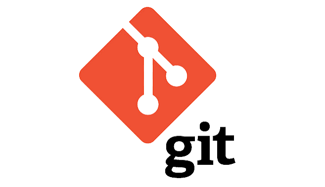
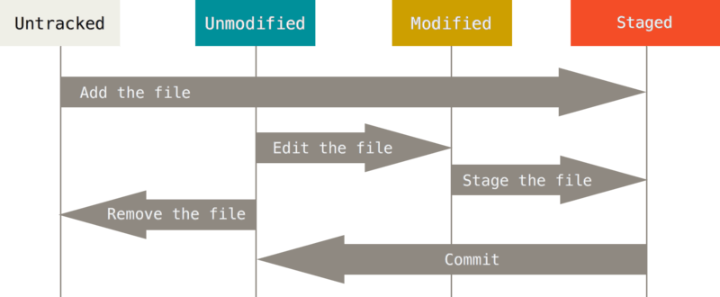
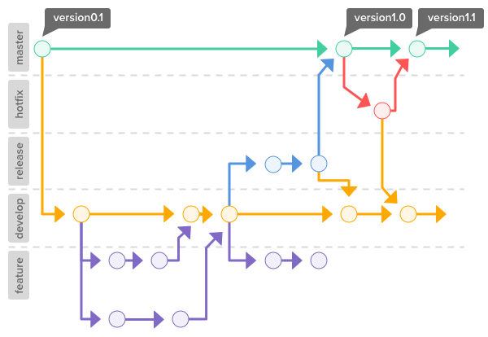
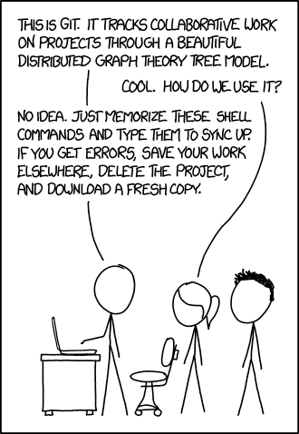

# Python Científico
## de la ecuación al programa
### Clase 5b - Git




---

## Configurar el sistema

<style scoped> section { font-size: 50px; } </style>

```bash
git config --global user.name "Nombre Apellido" 
git config --global user.email email@domain.com 
git config --global init.defaultBranch main
```

---

## Repositorios nuevos

- **Existente en Gitlab** No crear un directorio del proyecto.  
    Desde la raíz ejecutar  
    `git clone <URL>`  
    y se descarga el contenido a un directorio local
    
- **Existente en la computadora**
    
    ```
    cd <existing_folder>
    git init [-b main] [directory]
    ```

---

## URL de repositorios
<style scoped> section { font-size: 30px; } </style>

```bash

# SSH estilo scp
git clone usuario@host:/srv/git/practica-git.git

# SSH con URL completa
git clone ssh://usuario@host:2222/srv/git/practica-git.git

# HTTPS
git clone https://servidor/usuario/practica-git.git

# Carpeta local
git clone /ruta/a/practica-git.git

```

Hagan el clone y corran `git status`
Antes de seguir: `git switch -c nombre/saludo`

---

## Inspección del repositorio

```bash
git status
git branch

ls -R1

# Correr programa
uv run practica-git saludar Willy
uv run practica-git sumar 2 3

# Crear una rama propia
git switch -c tu-nombre/saludo-largo

```

---

## Estados de los archivos



---

## Comandos Útiles Locales

```bash
git status        # Estado de los archivos del proyecto 
git brach         # Listado de ramas
git add myNewFile # Track new File 
git add .         # Track all files except .gitignore
git commit -m 'my commit message'    # commit of staged Files 
git commit -a -m 'my commit message' # Stage all modified Files & commit 
git commit --amend                   # Redo last commit (for minor corrections) 
git rm myFile            # Borra un archivo del disco y lo deja de trackear 
git rm --cached myFile   # Deja de trackear, pero no borra del disco 
git mv myFile miArchivo  # Renombra archivo manteniendo registro de cambios`
```

---

## Repositorios

<style scoped> section { font-size: 60px; } </style>

```bash
git remote #lista aliases 
git remote -v #lista aliases & urls 
git remote add <shortname> <url> #add remote 
git fetch <remote> #carga la estructura. No modifica files de trabajo. 
git pull <remote> <branch> #fetch & merge in current branch (pueden aparecer conflictos) 
git push <remote> <branch> #uploads all commits`
```

---

## Flujos de trabajo




---

