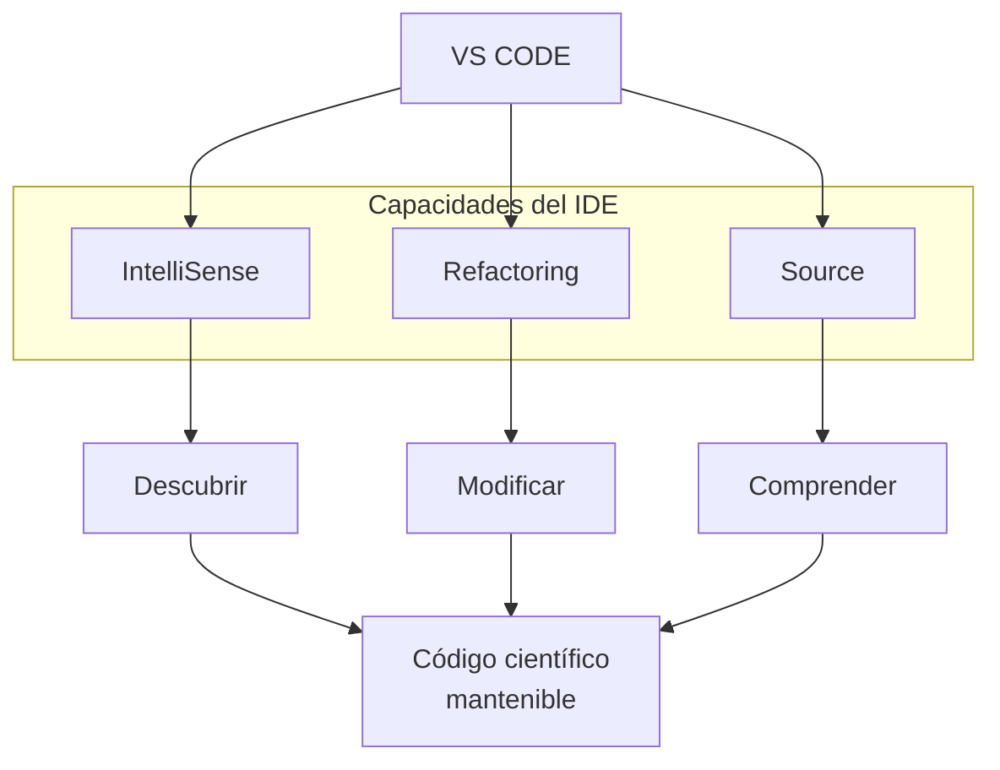

# Python Científico
## de la ecuación al programa
### Clase 6a -La magia del Visual Studio 

![[Pasted image 20261027082145.png]]

---
# Ayudas de edición
## IntelliSense

Permite descubrir:
- argumentos;
- valores por defecto;
- tipos;
- documentación;
- métodos disponibles.

o sea: 

**IntelliSense permite explorar una biblioteca desde el propio código**.


```python 
import numpy as np

np.

np.linspace(

np.linspace(start, stop, num=50)
```

##  Refactoring (F2) / Extract Function

-  Rename Symbol  (F2)
-  Extract Function

```python 
import numpy as npx = np.linspace(0, 10, 100)

y = np.sin(x)

maximum = np.max(y)
minimum = np.min(y)
average = np.mean(y)

print(maximum)
print(minimum)
print(average)
```

## Source (F12) / código fuente

```python
import numpy as np

x = np.linspace(0, 10, 100)
```



---

# GIT

Una de las ventajas de VS Code es que no necesitamos ejecutar todos los comandos desde la terminal.

En la barra lateral aparece:

**Source Control**

Desde allí podemos observar:
![[Pasted image 20261027092612.png]]

Podemos:
- revisar diferencias,
- hacer `stage`,
- crear commits,
- cambiar de rama,
- resolver conflictos.
