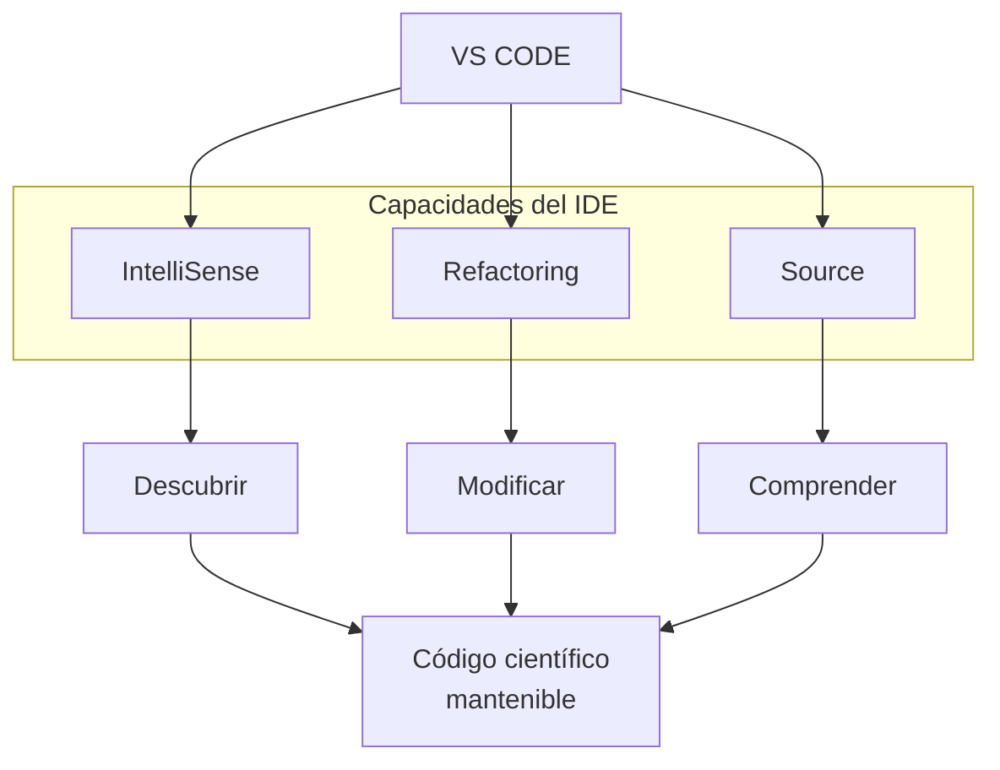

# Python Científico
## de la ecuación al programa
### Clase 6b - Beautiful is better than ugly
![[Pasted image 20261027105344.png|300]]

---
# Limpiando el código

Limpiar y reformatear el código mejora su legibilidad, facilita el mantenimiento y ayuda a detectar errores antes de que se conviertan en problemas. Mantener un estilo consistente reduce el ruido en las revisiones y permite concentrarse en la lógica y el contenido del programa, en lugar de en detalles de formato.

Herramientas como **Ruff** y **Black** automatizan estas tareas y ayudan a producir código más claro, consistente y fácil de compartir.
## Ruff

Analizar el código permite detectar errores potenciales, eliminar elementos innecesarios y mantener buenas prácticas de programación. Automatizar estas revisiones mejora la calidad y la confiabilidad del código.

- Detecta errores potenciales y malas prácticas.
- Identifica `imports` y variables sin usar.
- Aplica correcciones automática.    
- Verifica convenciones y reglas de estilo.

Antes:
```python 
import os
import sys

def calcular():
    resultado= 10+ 20
    mensaje = "Hola"
    return resultado

print(calcular( ) ) 
```

Después:
```python
def calcular():
	resultado = 10 + 20
	mensaje = "Hola"
	return resultado


print(calcular())
```
## Black

Reformatear el código mejora su legibilidad y mantiene un estilo consistente en todo el proyecto. Automatizar el formato facilita el mantenimiento, la revisión y el trabajo colaborativo.

- Reformatea automáticamente el código.    
- Unifica espacios, indentación y saltos de línea.    
- Mantiene un estilo consistente en todo el proyecto.    
- Facilita la lectura, revisión y mantenimiento del código.

Antes:
```python 
def calcular_total(precio,cantidad,descuento=0):
    total=precio*cantidad
    if descuento>0:
        total=total-(total*descuento)
    return total
```

Después:
```python
def calcular_total(precio, cantidad, descuento=0):
	total = precio * cantidad
	if descuento > 0:
		total = total - (total * descuento)
	return total
```

En resumen: 
- **Ruff** revisa el código para detectar problemas; 
- **Black** normaliza su formato sin cambiar la lógica del programa.
## Artificial Inteligent 

```python
import numpy as np

x = np.linspace(0, 10, 100)
```



---

# GIT

Una de las ventajas de VS Code es que no necesitamos ejecutar todos los comandos desde la terminal.

En la barra lateral aparece:

**Source Control**

Desde allí podemos observar:
![[Pasted image 20261027092612.png]]

Podemos:
- revisar diferencias,
- hacer `stage`,
- crear commits,
- cambiar de rama,
- resolver conflictos.
